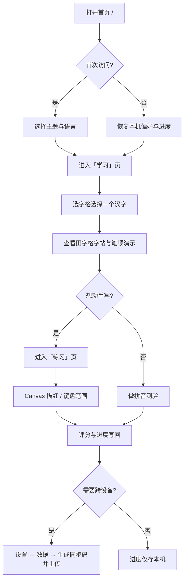
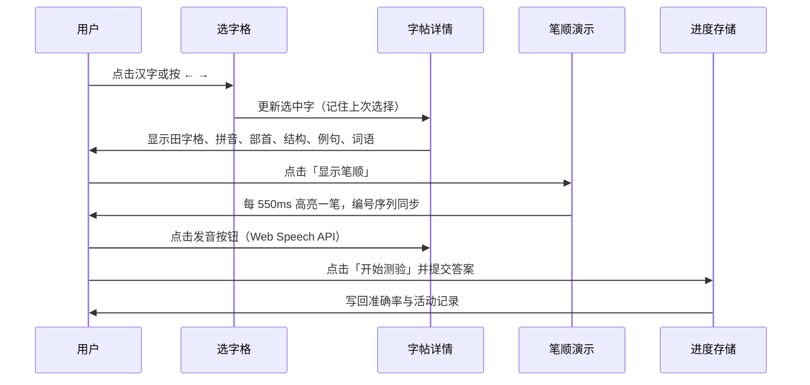
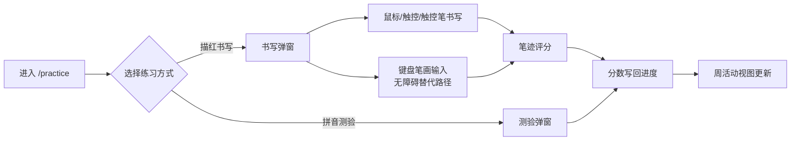
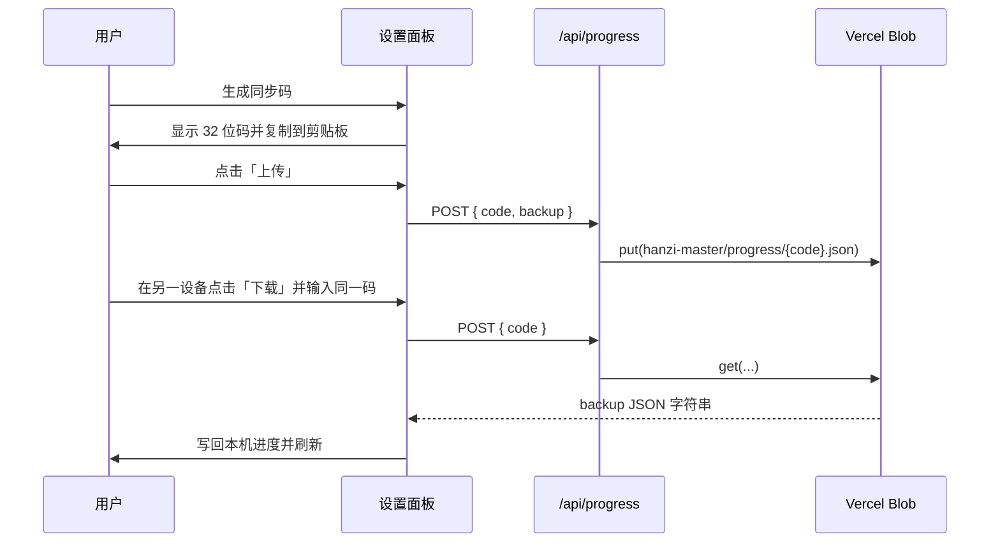

# 用户操作指南

> 文档版本：v5.2.61（与项目版本同步，权威版本见 `package.json`）

本文面向**最终用户**，说明如何第一次使用、完成一次完整学习闭环、管理进度与偏好。开发者接口见 [04-api-reference.md](04-api-reference.md)，故障处理见 [09-faq-troubleshooting.md](09-faq-troubleshooting.md)。界面截图位于 `docs/assets/screenshots/`（`home-light.png` / `home-dark.png` / `learn.png` / `practice.png`；部分截图为历史版本，界面以当前实现为准）。

## 1. 开始之前

### 1.1 产品定位

HanziMaster 汉字大师是一个**纯前端、本地优先**的汉字书写学习应用：无需注册、无需账号、无服务端学习记录。打开浏览器即可使用；进度默认只保存在当前浏览器。

### 1.2 角色与权限说明

项目**没有用户账户体系、没有登录、没有服务端角色表**。实际权限由「数据所在位置」决定，可理解为三种事实角色：

| 事实角色 | 获得方式 | 可以做什么 | 不能做什么 |
|---------|---------|-----------|-----------|
| 本机用户 | 打开页面即可 | 学习 12 个汉字、书写练习、测验、查看本机进度、修改主题/语言/设置 | 无法读取其它浏览器或设备的进度 |
| 同步码持有者 | 在设置面板生成或拿到他人同步码 | 通过 POST `/api/progress` 读取/覆盖对应云端备份 | 无法区分是谁操作；无法撤销他人持有的码 |
| 站点管理员 | 部署环境变量的持有者 | 配置 Blob 凭证 GA4 / Sentry / 正式域名 | 不接触用户学习记录（应用不上传学习明细） |

> **安全提示**：同步码是 32 位小写十六进制字符串，等同于密码。任何持有者都可读取或覆盖备份；请仅在可信设备间传递，不要公开分享。同步码只经 POST 请求体发送，不会出现在 URL 或访问日志中。

### 1.3 浏览器要求

- 最近两个主要版本的 Chrome / Firefox / Safari / Edge。
- 必须启用 JavaScript、`localStorage` 与 Canvas。
- 发音功能额外依赖 Web Speech API；部分 WebView 不支持时会给出错误提示，不影响其它功能。
- 移动端支持触控与触控笔；书写练习支持键盘输入笔画作为无障碍替代路径。

## 2. 整体使用流程

## 3. 第一次使用

### 3.1 选择语言与主题

1. 页面顶部导航栏提供语言快捷按钮与「设置」入口。
2. 语言快捷按钮在 11 种语言间循环；完整下拉在 **设置 → 外观 → 语言**。
3. 主题可选「浅色 / 深色 / 跟随系统」，同样位于 **设置 → 外观**。
4. 语言会写入 `?lang=` 与 `hanzi-master-locale` cookie；下次访问 `/{locale}/...` 可直接进入对应语言页面。阿拉伯语为 RTL，界面自动镜像，但笔顺 SVG 与田字格 Canvas **不会被镜像**（否则字形错误）。

### 3.2 认识三个页面

| 页面 | 路径 | 用途 |
|------|------|------|
| 首页 | `/` | 产品介绍、可播放的笔顺演示、特性与 FAQ |
| 学习 | `/learn` | 选字、字帖详情、笔顺演示、发音、学习测验 |
| 练习 | `/practice` | 书写练习、拼音测验、周活跃统计 |

导航在桌面端显示为顶部链接，移动端折叠为菜单按钮；键盘用户可使用跳转链接（skip link）直达主内容。

## 4. 学习一个汉字

### 4.1 选字

1. 进入 `/learn`，页面显示 12 个基础汉字的选字格。
2. 用鼠标/触摸点击任一字；键盘用户可用 **← / →** 切换（在输入框聚焦时快捷键自动失效，不会打断输入）。
3. 上次选中的字会被记住，刷新后仍保持。

### 4.2 阅读字帖

字帖页分左右两栏（移动端上下堆叠）：

- **左页**：田字格中的大字、拼音与发音按钮、笔画数、含义、部首、结构。
- **右页**：例句、词语与短语、笔顺演示。
- 中文界面下，词语译文与词条相同时不重复显示；繁体或英文界面会显示差异译文。

### 4.3 播放笔顺

1. 在字帖右栏找到「笔顺 / Stroke Order」区块。
2. 点击「显示笔顺」：笔画按正确顺序依次以朱砂红高亮，每 550 毫秒一笔；编号方格标出当前笔。
3. 播放结束后再次点击可从第一笔重播；「清除」按钮重置进度。
4. 静止状态下所有笔画为淡色轮廓，便于先自行回忆再播放。

### 4.4 做学习测验

1. 点击字帖底部「开始测验」。
2. 从 4 个选项中选择正确答案；支持键盘方向键在选项间移动、回车确认。
3. 提交后结果区通过 `aria-live` 播报，选项显示正确/错误状态。
4. 结果计入本机进度的准确率与活动记录。

## 5. 书写练习

1. 进入 `/practice`，在「练习方式」网格中选择**描红书写**或**拼音测验**。
2. 书写弹窗中，田字格会显示淡色字形与笔顺引导；用鼠标、手指或触控笔沿笔画书写。
3. 无法使用指针设备时，切换到键盘笔画输入：按提示的笔画序列输入，评分与指针路径共享同一判定逻辑。
4. 抬笔后即时给出评分；评分由「命中率 + 方向覆盖 + 形状贴合」综合得出，计入进度。
5. 弹窗支持 Esc 关闭、焦点陷阱与关闭后焦点归还。

## 6. 查看与管理进度

### 6.1 查看统计

`/practice` 页面展示累计准确率、连胜天数与最近 7 天活动。统计口径：

- **准确率**：答对次数 / 总答题次数；全对才显示 100%，199/200 显示 99%（避免四舍五入误报满分）。
- **连胜**：按 UTC 日序号连续计算；未来日期的脏数据会被过滤。
- **周活动**：最近 7 天有练习记录的天数。

### 6.2 导出与导入（JSON）

1. 打开 **设置 → 数据**。
2. 点击「导出备份」下载 JSON 文件；文件含版本号、导出时间与进度快照。
3. 点击「导入备份」选择合法 JSON；非法文件会被拒绝且**不会覆盖**现有进度。
4. 导入成功后所有已挂载的进度组件自动刷新。

### 6.3 云端同步（可选）

> 仅当部署方配置了 Vercel Blob 凭证时可用；未配置时按钮会提示不可用，应用保持纯本地模式。

1. **设置 → 数据 → 云同步 → 生成同步码**。覆盖旧码前会二次确认。
2. 复制同步码并妥善保存；剪贴板不可用时请手动选中文本复制，注意 32 字符不要抄错。
3. 点击「上传」把**当前本机进度**写入云端；本机无进度时上传会被拒绝。
4. 在另一设备输入同一同步码，点击「下载」写回进度。
5. 同步是**纯手动**操作，不会自动后台同步；修改后请记得重新上传。

### 6.4 重置进度

**设置 → 数据 → 重置学习进度**，危险操作需二次确认。重置后本机进度被删除；云端备份不会被自动删除，需手动重新上传空备份（注意服务端会拒绝空进度写入）。

## 7. 其它设置

| 设置项 | 位置 | 说明 |
|-------|------|------|
| 主题 | 设置 → 外观 | 浅色 / 深色 / 跟随系统 |
| 语言 | 设置 → 外观 | 11 种语言，切换后 URL 与 cookie 同步更新 |
| 震动反馈 | 设置 → 反馈 | 支持时给出轻振动 |
| 减少动效 | 设置 → 动效 | 关闭滚动揭示与其它装饰动画 |
| 统计同意 | 首访同意横幅 / 设置 | 未同意前不加载 GA4；可撤回 |
| 安装为应用 | 浏览器可安装时出现 | PWA 离线兜底（网络优先 + 离线页） |

## 8. 移动端与无障碍提示

- 移动端导航折叠为菜单；字帖两栏改为上下堆叠，按钮固定在底部操作条。
- 深色模式完整支持，笔顺与田字格在深色下有独立配色。
- 阿拉伯语界面为 RTL；笔顺 SVG 与田字格 Canvas 保持正确的书写方向。
- 所有弹窗支持键盘操作与焦点归还；测验选项支持方向键导航；结果通过 `aria-live` 播报。
- 书写练习提供键盘笔画输入，作为 Canvas 指针操作的无障碍替代。

## 9. 相关文档

- [01-overview.md](01-overview.md) 项目概述
- [05-deployment.md](05-deployment.md) 部署指南
- [09-faq-troubleshooting.md](09-faq-troubleshooting.md) FAQ 与故障排除
- [10-optimization-roadmap.md](10-optimization-roadmap.md) 优化建议与未来展望
- [04-api-reference.md](04-api-reference.md) 开发者 API 参考
